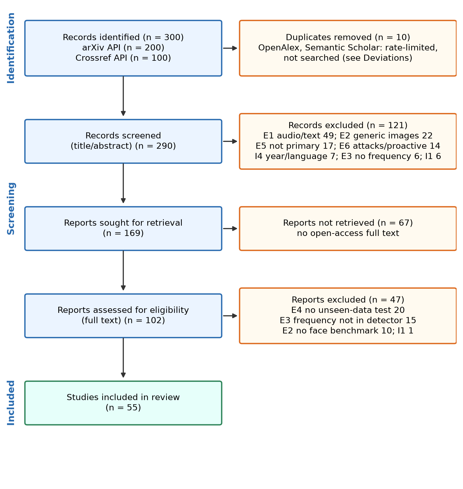

# Frequency-Domain Cues for Generalizable Deepfake Detection: A Systematic Literature Review

This repository holds the data and scripts for a systematic literature review (SLR) on frequency-domain face deepfake detection. The review follows PRISMA 2020 and the Kitchenham and Charters (2007) guidelines. It uses the [systematic-review-pipeline](https://github.com/nayeem-hossain/systematic-review-pipeline) toolkit.

**Author:** Mst. Fatema Nusrat, Department of Software Engineering, Daffodil International University
**Supervisor:** Dr. Rubaiyat Islam

> **Status: draft, first search run (12 Nov 2026).**
> All screening and extraction decisions are AI-assisted proposals. They are being checked by hand against each paper. Do not cite the numbers yet.

## Research questions

1. **RQ1.** Which frequency representations do face deepfake detectors use?
2. **RQ2.** Which datasets, protocols and metrics are used to test generalization?
3. **RQ3.** Do studies show a gain on unseen data over an RGB-only baseline trained the same way?
4. **RQ4.** Which frequency bands are reported as useful, and is this tested on unseen data?
5. **RQ5.** What reproducibility gaps and limitations do the studies report?

The full scope, criteria and search plan are in [`protocol.md`](protocol.md).

## Current numbers (first run)

| Stage | Count |
| --- | --- |
| Records identified (arXiv 200, Crossref 100) | 300 |
| Duplicates removed | 10 |
| Screened by title and abstract | 290 |
| Excluded at title and abstract | 121 |
| Sought for full text | 169 |
| Not retrieved (no open-access PDF) | 67 |
| Assessed at full text | 102 |
| Excluded at full text | 47 |
| **Included studies** | **55** |



## Repository structure

| Path | Content |
| --- | --- |
| `protocol.md` | Review protocol: PICOC, research questions, criteria, search plan |
| `output/query.txt` | The search string |
| `output/*_search_strategy.csv` | Search log per source (date, query, count) |
| `output/candidates.csv` | All 300 records found |
| `output/candidates_dedup.csv` | Records after duplicate removal |
| `output/screening.csv` | Title/abstract and full-text decisions with reasons for all 290 records |
| `output/no_oa.csv` | The 67 reports with no open-access full text |
| `output/ft_evidence.csv` | Full-text keyword evidence used for screening |
| `output/extraction.csv` | Extraction matrix and R/A/T/C quality ratings for the 55 included studies |
| `output/citation_check.csv` | DOI check of every included study against the arXiv API |
| `figs/` | PRISMA diagram and result charts |
| `ta_decisions.py`, `ft_decisions.py` | Title/abstract and full-text decision lists with exclusion codes |
| `ft_check.py` | Full-text evidence collector (needs the PDFs and `pdftotext`) |
| `code_extract.py` | First-pass extraction coding (needs the PDFs) |
| `make_slr_figs.py` | Builds the figures from the CSV files |

The PDFs are not included because of copyright.

## How to rebuild the figures

You need Python 3.

```bash
pip3 install pandas matplotlib
python3 make_slr_figs.py
```

The figures are saved in `figs/`. Run this again after you change `output/extraction.csv`.

## Quality rubric (R/A/T/C)

Each study is rated Low (L), Some (S) or High (H) concern on four dimensions.

- **R (Rigor):** tests on unseen data, and an RGB-only ablation.
- **A (Artifacts):** the authors release their code.
- **T (Threat model):** a robustness test and a limitations section.
- **C (Currency):** recent datasets.

L counts 2, S counts 1 and H counts 0. If R or T is H, the tier is C. Otherwise 7 to 8 points give tier A, 5 to 6 give B and 0 to 4 give C.

## Known limitations of this run

- Only arXiv and Crossref were searched. OpenAlex and Semantic Scholar returned rate-limit errors.
- Both sources returned relevance-ranked samples (first 200 and first 100), not the full result set.
- No citation snowballing has been done yet.
- 67 reports had no open-access full text.
- Extraction values were first coded with keyword rules and need manual checking.
- One reviewer so far. Inter-rater agreement is not yet computed.
- The toolkit's arXiv endpoint was changed from HTTP to HTTPS. The search logic was not changed.

## Next steps

- [ ] Confirm every screening and extraction decision by hand
- [ ] Add Scopus and IEEE Xplore searches, and re-run OpenAlex and Semantic Scholar
- [ ] Add backward and forward snowballing
- [ ] Get the missing full texts through the library
- [ ] Second reviewer on a 20 to 30% sample, and report Cohen's kappa

## Use of AI tools

An AI assistant (Claude, Anthropic) ran the search scripts and proposed the screening decisions, extraction values and quality ratings. Every row records this in the `reviewer` and `decision_source` columns. The human reviewer confirms or changes each decision. DOIs were checked with a script, not with the AI.

## References

- Page, M. J., et al. (2021). The PRISMA 2020 statement: an updated guideline for reporting systematic reviews. *BMJ*, 372, n71. https://doi.org/10.1136/bmj.n71
- Kitchenham, B., and Charters, S. (2007). *Guidelines for performing systematic literature reviews in software engineering* (EBSE-2007-01). Keele University and Durham University.
